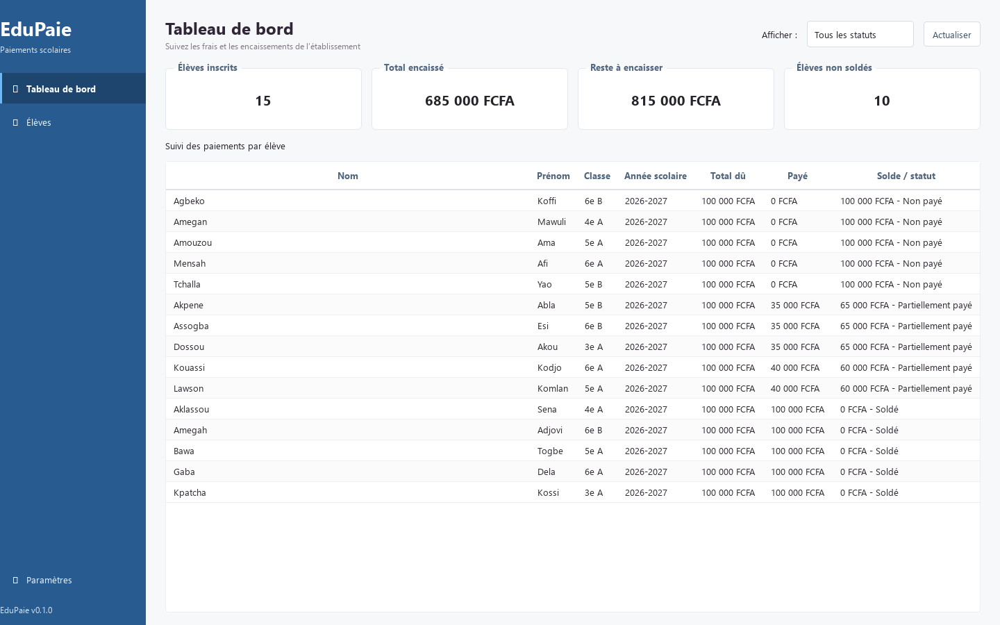
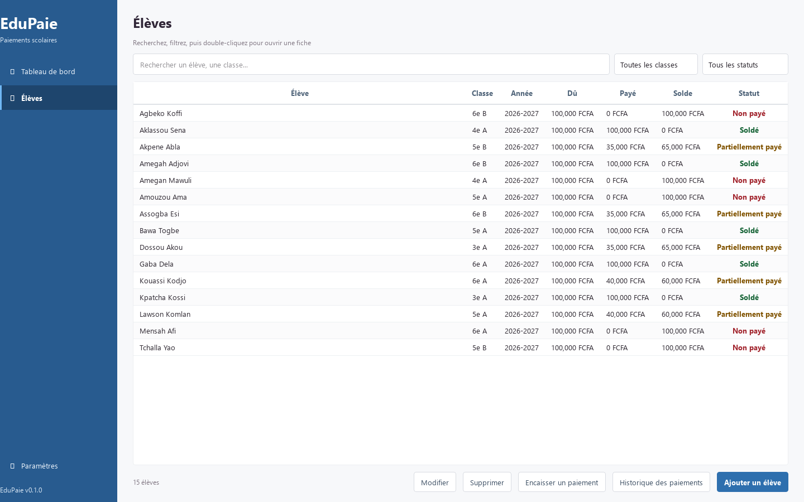
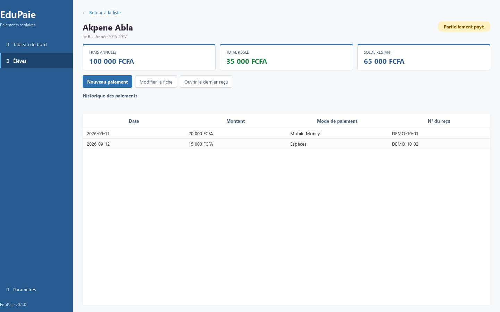

# Documentation technique - EduPaie

## 1. Présentation

EduPaie est une application de bureau destinée au suivi des inscriptions financières d'un établissement scolaire. Elle conserve une fiche par élève et enregistre les versements successifs associés à cette fiche. L'utilisateur voit le statut de règlement, le solde restant, les reçus et les totaux globaux.

Le projet privilégie une installation locale simple : l'interface fonctionne sur Windows, SQLite stocke les données sur l'ordinateur et les reçus sont des PDF. La version autonome regroupe Python, Qt et les bibliothèques nécessaires; le poste de destination n'a donc pas besoin d'une installation Python.

## 2. Architecture retenue

Le code suit une séparation en quatre responsabilités :

| Couche | Emplacement | Rôle |
| --- | --- | --- |
| Interface | `src/ui/` | Afficher le tableau de bord, la liste et la fiche d'un élève; recueillir les champs dans des formulaires PySide6. |
| Services | `src/services/` | Appliquer les règles de paiement, calculer les indicateurs et produire les reçus PDF. |
| Accès aux données | `src/data1/` | Exécuter les requêtes SQLite et regrouper les opérations de lecture/écriture dans des dépôts. |
| Persistance et fichiers | `database/`, `data/`, `%LOCALAPPDATA%\EduPaie\` | Décrire le schéma, fournir le jeu de démonstration et conserver la base active et les reçus. |

La vue ne construit pas directement les requêtes complexes. `PaiementService` vérifie le montant et le solde, crée le reçu associé au paiement dans une transaction SQLite, puis appelle `RecuService` pour générer le PDF. Les dépôts `EleveRepository` et `PaiementRepository` portent les requêtes de consultation.

### Parcours d'un paiement

1. Le formulaire transmet l'élève, le montant, la date et le mode.
2. Le service confirme que le montant est positif et ne dépasse pas le solde.
3. Le service crée le numéro et les données figées du reçu.
4. Le reçu et le paiement sont enregistrés ensemble dans une transaction SQLite.
5. `RecuService` écrit le reçu PDF dans le dossier local des reçus.
6. L'interface actualise le solde et l'historique.

Si l'écriture du PDF échoue après l'enregistrement, le paiement reste conservé dans la base et l'interface peut afficher le problème du reçu. Le fichier PDF peut être réimprimé depuis l'historique lorsque le fichier est disponible.

## 3. Modèle de données

Le schéma SQL se trouve dans `database/schema.sql`. Le diagramme ci-dessous représente les relations principales.

```mermaid
erDiagram
    CLASSES ||--o{ ELEVES : regroupe
    ANNEES_SCOLAIRES ||--o{ ELEVES : inscrit
    ELEVES ||--o{ PAIEMENTS : effectue
    RECUS ||--o| PAIEMENTS : justifie

    CLASSES {
        integer id PK
        text nom UK
    }
    ANNEES_SCOLAIRES {
        integer id PK
        text libelle UK
    }
    ELEVES {
        integer id PK
        text nom
        text prenom
        integer classe_id FK
        integer annee_scolaire_id FK
        real total_du
        text cree_le
    }
    PAIEMENTS {
        integer id PK
        integer eleve_id FK
        real montant
        text date_paiement
        text mode_paiement
        integer recu_id FK_UK
    }
    RECUS {
        integer id PK
        text numero UK
        text date_emission
        text contenu_json
    }
    PARAMETRES {
        text cle PK
        text valeur
    }
```

`classes` et `annees_scolaires` sont des référentiels. Un élève appartient à une classe et une année scolaire. Les paiements sont liés à un élève; chaque paiement référence un reçu unique. Le contenu JSON du reçu conserve les informations utilisées à l'encaissement, même si la fiche de l'élève change ensuite. Les contraintes SQL empêchent les montants dus négatifs, les paiements nuls/négatifs et les modes de paiement inconnus.

Le solde n'est pas stocké séparément : il est calculé par `total_du - somme(paiements)`. Cela évite que le solde enregistré diverge de l'historique des versements.

## 4. Choix techniques

- **PySide6** fournit des formulaires et tableaux natifs sur Windows sans serveur Web.
- **SQLite** ne nécessite pas d'installation de serveur et convient à un usage local sur un poste.
- **FPDF2** génère des reçus PDF à partir des données conservées avec le paiement.
- **PyInstaller (onedir)** ou **Nuitka (standalone)** produisent un dossier autonome. Les bibliothèques Qt et les fichiers du programme doivent rester ensemble.
- Les données actives résident dans `%LOCALAPPDATA%\EduPaie\`, séparées du dossier de programme; une mise à jour de l'exécutable n'efface donc pas les données.
- La base de démonstration est séparée de la base active pour que les exercices ne modifient pas le fichier livré.

## 5. Jeu de démonstration et documentation d'écran

`data/edupaie_demo.db` contient 15 élèves fictifs : cinq sans paiement, cinq avec un solde partiel et cinq soldés. Les paiements d'exemple couvrent plusieurs dates et modes. Les captures suivantes illustrent le tableau de bord, la liste des élèves et une fiche détaillée.







## 6. Limites connues et évolutions possibles

- La base est locale à un profil Windows; il n'y a ni accès multi-poste ni synchronisation réseau.
- L'application n'a pas encore de comptes et rôles utilisateurs, ni journal d'audit des modifications.
- Les frais sont saisis sur chaque fiche; il n'existe pas encore de barème automatiquement associé à une classe.
- Les sauvegardes doivent être déclenchées manuellement et copiées sur un autre support.
- Les PDF utilisent l'identité générique EduPaie; l'établissement ne configure pas encore son nom, son logo ou ses coordonnées dans Paramètres.
- Les données de démonstration sont fictives et doivent être remplacées pour une utilisation réelle.

## 7. Démarrage et distribution

Les commandes d'installation depuis les sources et de création du dossier Windows sont dans `README.md`. Pour le destinataire, distribuer le dossier complet `EduPaie` ou une archive ZIP de ce dossier; ne jamais envoyer le seul `.exe`. La base de travail est créée dans le profil du nouvel utilisateur lors du premier démarrage.
